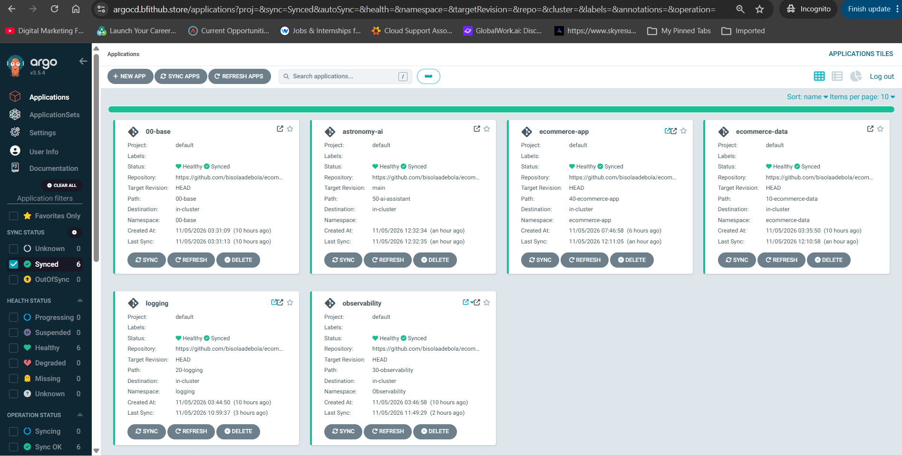
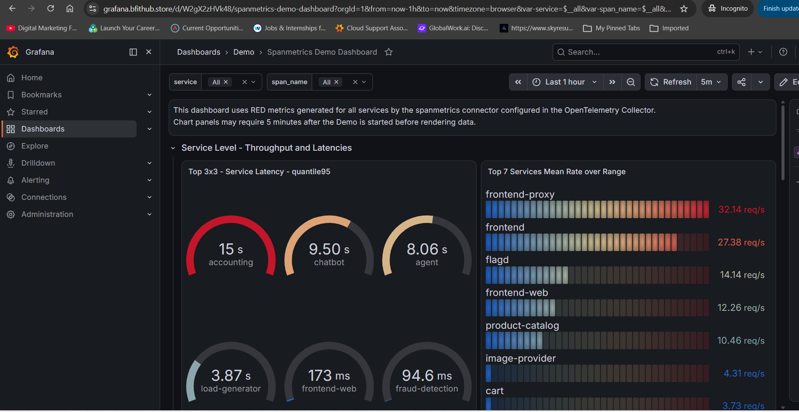
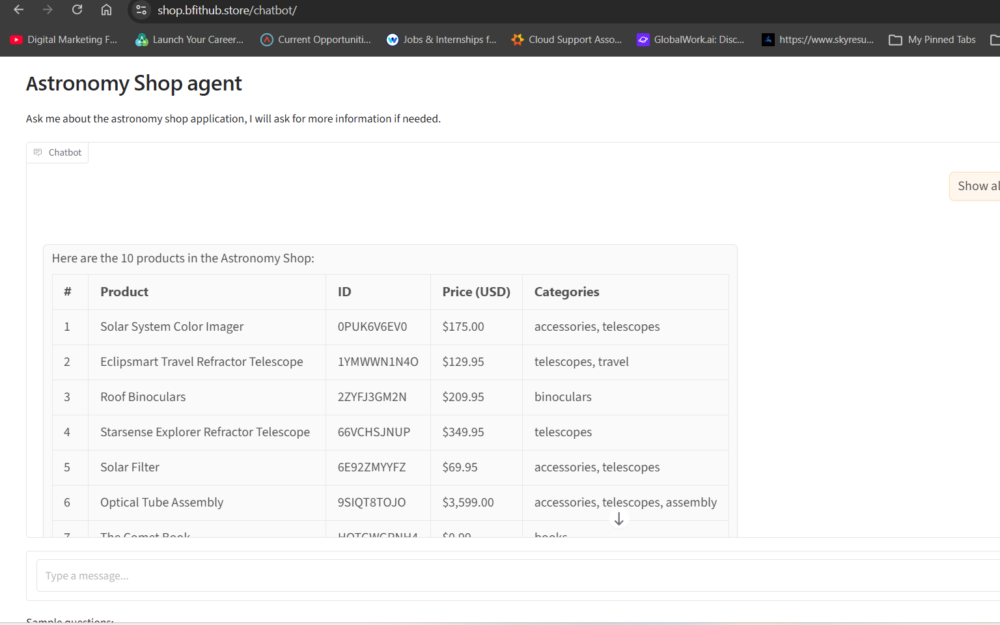
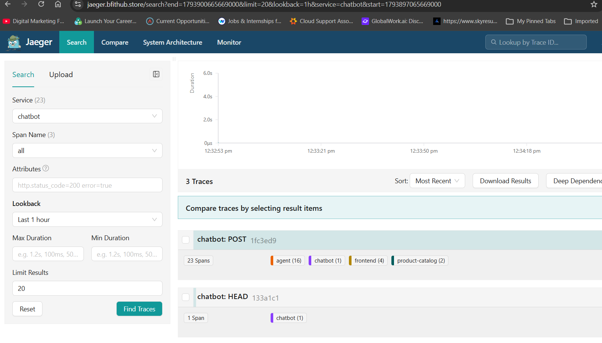
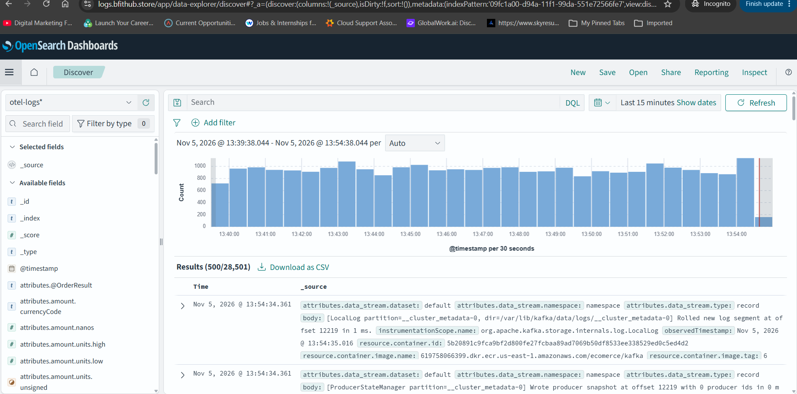

# Astronomy Shop on EKS

Kubernetes manifests for running the ecommerce-final-project microservices on the
Final-Project EKS cluster (`aws-network-and-eks-deployment`), deployed by
Argo CD with Kustomize.

## Deployment highlights

This 24-microservice platform is deployed from Git through Argo CD. The [ECR image build and manifest-update workflow](https://github.com/bisolaadebola/ecommerce-devsecops-platform#phase-3-ecr-image-build-and-manifest-update) builds and publishes images; this repository supplies the Kubernetes desired state.







## Layout

| Folder | Namespace | Contents | Argo CD app (wave) |
|---|---|---|---|
| `00-base/` | cluster-wide | 5 namespaces, `gp3` StorageClass, `letsencrypt-prod-mergeable` ClusterIssuer, optional NetworkPolicies | `astronomy-base` (-1) |
| `10-ecommerce-data/` | `ecommerce-data` | PostgreSQL, Valkey, Kafka (StatefulSets on gp3) | `astronomy-data` (1) |
| `20-logging/` | `logging` | OpenSearch, OpenSearch Dashboards, Ingress `logs.` (basic auth) | `astronomy-logging` (2) |
| `30-observability/` | `observability` | OTel Collector, OpAMP, Jaeger, Prometheus, Grafana, Ingresses `grafana.`, `jaeger.`, `prometheus.` | `astronomy-observability` (3) |
| `40-ecommerce-app/` | `ecommerce-app` | flagd, flagd-ui, 17 shop services, Ingress `shop.` | `astronomy-app` (4) |
| `50-ai-assistant/` | `ai-assistant` | chatbot, agent, mcp (chat at `shop.../chatbot/`) | `astronomy-ai` (5) |
| `argocd/root-app.yaml` | `argocd` | Parent app `astronomy-shop`: creates the 6 layer apps | — |
| `argocd/apps/` | `argocd` | One Argo CD Application per folder | — |
| `create-secrets.sh` | all | Creates every Secret (never stored in Git) | — |

## Public URLs

| URL | Service | Login |
|---|---|---|
| https://shop.bfithub.store | Shop (flags at `/feature`, Locust at `/loadgen/`, AI chat at `/chatbot/`) | public |
| https://grafana.bfithub.store | Grafana | Grafana admin (`grafana-admin` Secret) |
| https://jaeger.bfithub.store | Jaeger | basic auth |
| https://prometheus.bfithub.store | Prometheus | basic auth |
| https://logs.bfithub.store | OpenSearch Dashboards | basic auth |

## Prerequisites (EKS Terraform project)

1. Nodes big enough: about 6.4 GiB memory requested, 10.9 GiB limits -> 3 x `t3.large`.
2. `aws-ebs-csi-driver` add-on (for the `gp3` StorageClass).
3. Already there: NGINX ingress, cert-manager + `letsencrypt-prod`, Argo CD, EFS (`efs-sc`).
4. Images in ECR: run the "Build and Push Images to ECR" workflow.

## Deploy

```bash
# 1. Secrets (once)
bash create-secrets.sh

# 2. Give Argo CD read access to this private repo (UI -> Settings -> Repositories)

# 3. Create the parent app; it creates the 6 layer apps in wave order,
#    waiting for each to be Healthy before the next
kubectl apply -f argocd/root-app.yaml
#    (without Argo CD: kubectl apply --server-side -k .)

# 4. DNS: CNAME shop, grafana, jaeger, prometheus, logs -> NGINX load balancer
#    (terraform output load_balancer_hostname in the EKS project)

# 5. Each layer brings its own Ingress; certificates are issued once DNS resolves
kubectl get certificate -A
```

Image tags live in each layer's `kustomization.yaml` (`images:`); the
ecommerce-final-project pipeline updates them after every build.

Always use **server-side apply** (`--server-side`; the Argo CD apps already do):
two Grafana dashboard ConfigMaps are larger than the 256 KB client-side apply allows.

## Updating config copied from ecommerce-final-project

These files are copies (Kustomize can't read outside this folder). Re-copy them
when the originals change:

| Copy | Original |
|---|---|
| `10-ecommerce-data/config/01-init.sql` | `ecommerce-final-project/src/postgresql/init.sql` |
| `30-observability/config/grafana/dashboards/*.json` | `ecommerce-final-project/src/grafana/provisioning/dashboards/demo/*.json` |
| `30-observability/config/grafana/alerting/*` | `ecommerce-final-project/src/grafana/provisioning/alerting/*` |
| `30-observability/config/prometheus-config.yaml` | `ecommerce-final-project/src/prometheus/prometheus-config.yaml` |
| `30-observability/config/jaeger-ui-config.json` | `ecommerce-final-project/src/jaeger/ui-config.json` |
| `40-ecommerce-app/config/otel-config.yml` | `ecommerce-final-project/otel-config.yml` |
| `40-ecommerce-app/config/demo.flagd.json` | `ecommerce-final-project/src/flagd/demo.flagd.json` |
| `40-ecommerce-app/config/vcr_cassettes/*` | `ecommerce-final-project/src/agent/fixtures/vcr_cassettes/*` |

Adapted (not plain copies): `otelcol-config.yml`, `jaeger-config.yml`,
`grafana.ini`, `datasources.yaml`, `app.env`.


## Phase 3: Application Deployment with Argo CD

**DevOps Engineer:** BisolaAdebola

In Phase 3, I deployed the Astronomy Shop platform's 24 microservices to the Amazon EKS cluster provisioned in Phase 2. This repository is the GitOps source of truth: it holds the Kubernetes manifests, and Argo CD continuously reconciles the cluster to the desired state in Git.

### Image build and deployment flow

The [24-image ECR build and manifest-update workflow](https://github.com/bisolaadebola/ecommerce-devsecops-platform#phase-3-ecr-image-build-and-manifest-update) in the DevSecOps repository builds and pushes the service images to Amazon ECR, then commits their updated tags to this repository. Argo CD detects those manifest changes and deploys the updated workloads to EKS.

### Argo CD app-of-apps layout

The parent Argo CD application, `astronomy-shop`, manages six layer applications. Sync waves apply the layers in dependency order:

1. `astronomy-base` (wave -1) — namespaces, storage class, and cluster-wide configuration
2. `astronomy-data` (wave 1) — PostgreSQL, Valkey, and Kafka
3. `astronomy-logging` (wave 2) — OpenSearch and OpenSearch Dashboards
4. `astronomy-observability` (wave 3) — OpenTelemetry Collector, Jaeger, Prometheus, Grafana, and OpAMP
5. `astronomy-app` (wave 4) — the ecommerce shop services
6. `astronomy-ai` (wave 5) — chatbot, agent, and MCP services

The parent application is defined in `argocd/root-app.yaml`; the child applications are in `argocd/apps/`. The parent uses automated sync with pruning and self-healing enabled.

### Verification and observability

I verified the deployment in Argo CD and through the running services. The screenshots below show the synced and healthy applications, the shop and AI assistant, and project telemetry in Grafana, Jaeger, and OpenSearch Dashboards.







### Repositories for the three project phases

- Phase 1 — Infrastructure scanning and SonarQube server: [`sonarqube-aws-ec2`](https://github.com/bisolaadebola/sonarqube-aws-ec2)
- Phase 2 — AWS infrastructure deployment: [`ecommerce-eks-terraform-infrastructure`](https://github.com/bisolaadebola/ecommerce-eks-terraform-infrastructure)
- Phase 3 — Image pipeline: [`ecommerce-devsecops-platform`](https://github.com/bisolaadebola/ecommerce-devsecops-platform)
- Phase 3 — Kubernetes GitOps deployment: [`ecommerce-kubernetes-manifests`](https://github.com/bisolaadebola/ecommerce-kubernetes-manifests)
